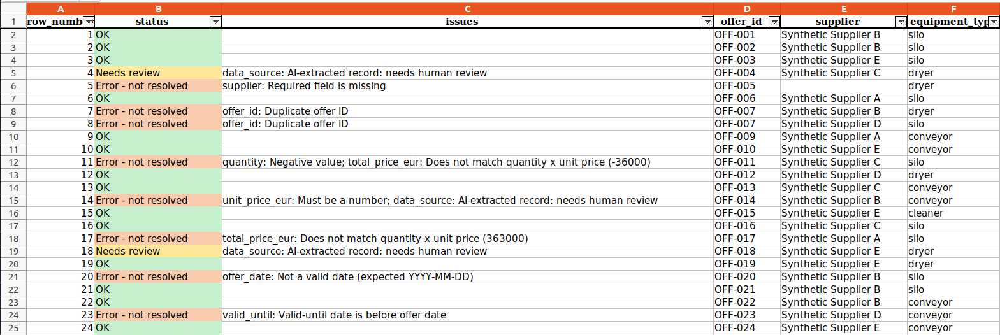
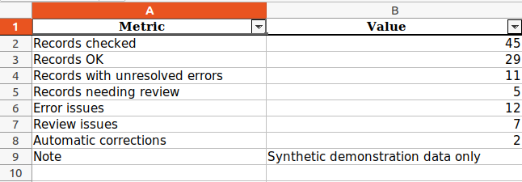

# Grain Storage Offer & Data Plausibility Checker

A small Python tool that checks equipment offer data for grain storage
(silos, conveyors, dryers, cleaners), corrects only safe formatting problems,
flags uncertain records for human review, and produces an Excel report.

> **Disclaimer:** This is an independent learning project. All data is synthetic
> and does not represent any real company, supplier or system.

## What it does

1. **Loads** a CSV file of offers.
2. **Cleans** only unambiguous formatting (extra spaces, capitalisation of fixed values).
   Every correction is logged. The original data is never changed.
3. **Validates** each record against documented rules.
4. **Reports** the results as a CSV issues list and a formatted Excel workbook.

## Quick start

Requires Python 3.8 or newer.

```bash
python3 -m venv .venv
source .venv/bin/activate
pip install -r requirements.txt

python scripts/generate_synthetic_data.py      # create the sample data
python -m grain_offer_checker.pipeline         # run all checks
python -m pytest -v                            # run the tests
```

Options: `python -m grain_offer_checker.pipeline --input FILE.csv --output FOLDER`

Run commands from the project folder.

## Output

`output/issues_report.csv`: one row per issue (row, offer ID, field, original value, reason, severity).

`output/review_report.xlsx` with six sheets:

| Sheet | Contents |
|---|---|
| Summary | Key numbers: records checked, OK, errors, reviews, corrections |
| Reviewed Data | All records with a colour-coded status: Error / Needs review / OK |
| Issues | Every issue found |
| Corrections | Every automatic correction (old value, new value) |
| Offer Comparison | Price per capacity unit by equipment type (OK records only) |
| Original Data | The unchanged input |





## Data fields and demonstration rules

These are my own demonstration rules, not taken from any real organisation.

| Field | Meaning | Rule |
|---|---|---|
| offer_id | Unique offer number | Required, must be unique |
| supplier | Fictional supplier name | Required |
| equipment_type | silo, conveyor, dryer or cleaner | Required, must be one of these |
| capacity_t | Tonnes (silo) or tonnes per hour (others) | Required, 1 to 20,000 |
| quantity | Units offered | Required, whole number, at least 1 |
| unit_price_eur | Price per unit | Required, at least 1 |
| total_price_eur | Total price | Required, must equal quantity x unit price (±1 €) |
| offer_date | Offer date (YYYY-MM-DD) | Required, must be a real date |
| valid_until | Expiry date (YYYY-MM-DD) | Required, not before offer_date |
| delivery_weeks | Delivery time | Optional; if filled, whole number 1 to 52 |
| data_source | manual_entry or ai_extracted | Required; ai_extracted is always flagged for review |

**Severity:** `error` = definitely wrong; `review` = may be fine, but a person must check it.

## Correction policy

Data is corrected automatically **only when there is exactly one sensible interpretation**:

- Fixed: extra spaces; capitalisation of `equipment_type` and `data_source`.
- Not fixed (left for a person): missing values, negative or out-of-range numbers,
  invalid dates, decimal commas and other date formats, because they are ambiguous.

## Test data

`scripts/generate_synthetic_data.py` creates 45 offers with a fixed random seed,
then plants 12 documented problems (see the comments in the script).
The expected result is the "answer key" used by the end-to-end test:
45 records, 29 OK, 11 with unresolved errors, 5 needing review, 2 automatic corrections.

## Project structure

```
grain_offer_checker/
  validation.py   rules and checks
  cleaning.py     safe formatting corrections
  reporting.py    tables, CSV and Excel export
  pipeline.py     runs everything; command-line options
scripts/          synthetic data generator
tests/            pytest tests (13)
data/raw/         synthetic input data
```

## Limitations

- Prices and capacities are random synthetic values; the Offer Comparison shows the method, not real prices.
- Capacity units differ by equipment type, so prices are only compared within the same type.
- Input must contain all expected columns; missing columns are not yet handled gracefully.
- Validation checks only the documented demonstration rules. An OK status does not prove that an offer is accurate or commercially suitable.


## Possible extensions

Multiple-file import, a change history, a review dashboard, a database (PostgreSQL),
an API (FastAPI), Docker and automated tests in CI.


